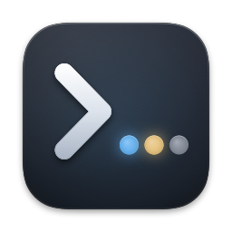
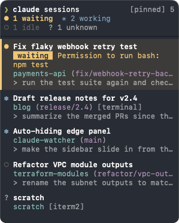

# ClaudeWatcher

A macOS auto-hiding left-edge sidebar that lists your running [Claude Code](https://claude.com/claude-code)
sessions and jumps to their Ghostty / Terminal.app tab, even across Spaces/desktops.



## Features

- Auto-hiding bar on the left screen edge, revealed by moving the pointer there (like the Dock).
- Each row shows the session title, folder, git branch and status (working / waiting for you / idle);
  sessions waiting for input float to the top.
- Click a row to focus its exact Ghostty or Terminal.app tab, switching Spaces if needed.
  Other terminals: the hosting app is brought to the front.
- Pinned, drag the sidebar's right edge to resize it (double-click to reset); the width is kept.
- Menu bar: Pin Sidebar, Reset Sidebar Width, Claude Code Hook (install / update / uninstall), Launch at Login, Quit.
- Demo mode: `open build/ClaudeWatcher.app --args --demo`.

## Install

1. Download `ClaudeWatcher-X.Y.Z.dmg` from the
   [latest release](https://github.com/thegoldenmule/claude-watcher/releases/latest) and open it.
2. Drag **ClaudeWatcher** onto the **Applications** folder in the window that opens, then eject
   the disk image.
3. Open ClaudeWatcher from Applications. It lives in the menu bar; the sidebar slides in from
   the left screen edge.

The app is signed with Developer ID and notarized by Apple. Each release also has
`ClaudeWatcher-X.Y.Z.zip` (the same app, for scripted installs) and `ClaudeWatcher-X.Y.Z.sha256`
covering both: `shasum -a 256 -c --ignore-missing ClaudeWatcher-X.Y.Z.sha256`.

## Requirements

macOS 26 and Ghostty 1.3+ or Terminal.app. Building from source also needs a Swift 6.2+
toolchain (Xcode 26 command-line tools).

## Build and run

```sh
make run    # build, sign and launch build/ClaudeWatcher.app
make test   # unit tests
```

Signing uses `$CODESIGN_IDENTITY`, else your first "Apple Development" identity, else ad hoc
(ad hoc resets permission grants on every rebuild).

## Permissions

Only **Automation** for Ghostty / Terminal.app, asked on first click. No Accessibility or
Input Monitoring access is needed.

## Optional Claude Code hook

**Install Hook** in the menu bar adds a hook to `~/.claude/settings.json` (with a backup) that
records each session's terminal id and tty to `~/Library/Application Support/ClaudeWatcher/hook-state/`.
It never blocks Claude and only affects sessions started after install. Without it, Ghostty
tabs are still found on first click by a quick probe.

## How it works

Sessions come from `~/.claude/sessions/` and their transcripts; Ghostty tabs are matched by an
OSC 7 probe (a nonce cwd written to the session's tty) via Ghostty's AppleScript.

## Releasing

```sh
make release VERSION=1.2.3                       # notarized universal app (DMG + zip) -> GitHub release
make release VERSION=1.2.3 DRY_RUN=1             # Developer ID-signed DMG + zip in build/dist/ only
make release VERSION=1.2.3 DRY_RUN=1 NOTARIZE=1  # also notarized and stapled; still nothing published
make dmg                                         # preview the DMG window with the dev app (build/ClaudeWatcher.dmg)
```

The DMG needs Python 3.10+ (`brew install python`; macOS's own 3.9 is too old):
`scripts/build-dmg.sh` installs [dmgbuild](https://github.com/dmgbuild/dmgbuild), pinned with
hashes in `scripts/dmg-requirements.txt`, into a private venv and writes the window layout
without Finder or AppleScript.

Releases are signed and notarized with the Apple account signed into Xcode
(Xcode › Settings › Accounts), the same way as
[claude-tray](https://github.com/thegoldenmule/claude-tray). There are no certificates,
passwords or notary profiles to set up. The account needs the Account Holder or Admin role
on the team, with access to cloud-managed Developer ID certificates.

`make release` (see `scripts/release.sh`) checks that main is clean and in sync with origin.
It sets `CFBundleShortVersionString` to the version and `CFBundleVersion` to the commit
count, then commits and tags `vX.Y.Z` locally. `scripts/build-app.sh` builds a universal
(arm64 + x86_64) app in `.build-release`, signed with the hardened runtime and
`Resources/ClaudeWatcher.entitlements`. That file holds only
`com.apple.security.automation.apple-events`, which the hardened runtime needs before the app
can script Ghostty and Terminal.app. The app stays unsandboxed.

The app is wrapped in an `.xcarchive` and exported with
`xcodebuild -exportArchive -allowProvisioningUpdates` (method `developer-id`). That signs it
with a cloud-managed Developer ID certificate, keeping the entitlements, and uploads it for
notarization. `xcodebuild -exportNotarizedApp` then returns the notarized, stapled app. The
bundled hook script (`Contents/Resources/claude-watcher-hook.sh`) is a sealed resource,
covered by the app's signature.

The script packages the stapled app twice, as `build/dist/ClaudeWatcher-X.Y.Z.dmg` (a
drag-to-Applications window) and `ClaudeWatcher-X.Y.Z.zip`, and checks that the app inside
each passes Gatekeeper as a quarantined download. The DMG itself is deliberately left
unsigned: the cloud-managed certificate can't sign a disk image, and a disk image signed with
any other identity is refused on open; the app inside carries the signature and ticket. Only
then does it write `ClaudeWatcher-X.Y.Z.sha256` (covering both), push the commit and tag and
create the GitHub release with all three files. If anything fails before the push, it removes
the local commit and tag. Override the team with `TEAM_ID=...`.

Dev builds (`make app` / `make run`) are unchanged: Apple Development signing, no hardened
runtime and no notarization, so permission grants survive rebuilds.

## License

MIT — see [LICENSE](LICENSE).
